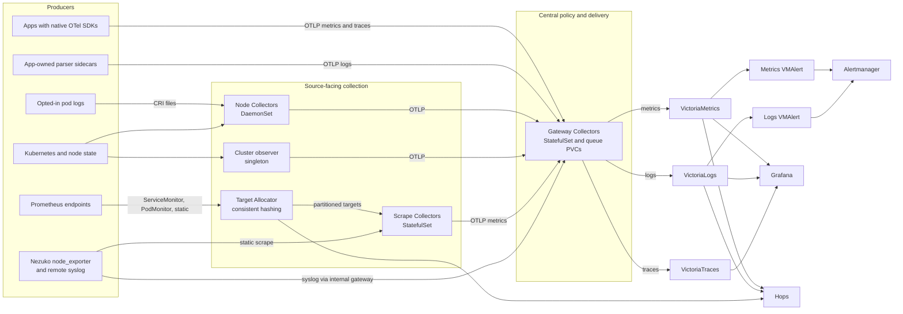

# Observability architecture

## Purpose

OpenTelemetry owns telemetry acquisition, enrichment, policy, and delivery. VictoriaMetrics,
VictoriaLogs, and VictoriaTraces store the three signals. Grafana, VMAlert, Alertmanager, and Hops
consume those backends. The [decision record][adr] defines the durable boundaries behind this
design.

## Topology



Deployment mode and configuration define each Collector role. The node, cluster, and scrape
Collectors run the upstream Kubernetes Collector build. The Gateway runs the contrib build because
the Kubernetes build has no syslog receiver.

Node Collectors use the host network, so their host metrics describe each node's real interfaces and
NFS client activity, not the Collector pod's own network namespace.

## Signal ownership

### Metrics

Every pod receives platform metrics from the node and cluster Collectors. Application metrics use
the interface documented by that workload:

- Native OTel SDK metrics go directly to the Gateway over OTLP.
- Prometheus endpoints are discovered through ServiceMonitor or PodMonitor resources. The Target
  Allocator partitions targets among the two Scrape Collector replicas, which convert samples to
  OTLP before forwarding them to the Gateway.
- Static jobs cover endpoints that do not have monitor resources, including node_exporter on Nezuko
  (Unraid). See the [Unraid telemetry runbook][unraid-telemetry].

Each metric family has one acquisition path, per the Telemetry rules in `AGENTS.md`. A workload uses
both paths only when the families differ, such as SDK request metrics and unique product metrics
from a Prometheus endpoint.

The `up` metric shows scrape health. Push health comes from a stable emitted metric with an absence
alert, Kubernetes workload health, and Collector receiver and exporter health. Environment variables
configure an SDK that already exists; they do not create metrics in an uninstrumented application.

### Logs

The node Collector reads CRI logs only for pods labeled `observability.home-ops/logs=true`. The
pod-level label includes every container. Platform Collectors perform CRI parsing, generic severity
handling, and Kubernetes enrichment.

Private file formats stay with the application. A sidecar Collector parses those files and exports
normalized OTLP logs. Those streams skip node log collection, which would duplicate the records.

Nezuko (Unraid) forwards its system log as RFC3164 syslog over UDP to port 514 on the internal
gateway, which passes it to the Gateway Collectors' syslog receiver and drops datagrams from any
other source address. Records carry `service.name=unraid-syslog` and enter the same queued logs
pipeline as other logs.

#### Sidecar config rollout

The Operator injects a sidecar Collector only when a pod is created. It renders the
`OpenTelemetryCollector` config into the injected container's `OTEL_CONFIG` environment variable, so
later changes to that resource never reach running pods. Upstream treats this as intended
([opentelemetry-operator#2078][otel-operator-2078]); Flux still reports the resource as ready.

Each sidecar consumer therefore generates a trigger ConfigMap from its Collector manifest and mounts
it read-only into an application container defined in the workload template:

```yaml
# kustomization.yaml
configMapGenerator:
- name: <app>-collector-trigger
  files:
  - collector.yaml=./collector.yaml
generatorOptions:
  disableNameSuffixHash: true
```

`reloader.stakater.com/auto` then rolls the workload whenever the Collector manifest changes. The
mount matters because Reloader ignores ConfigMap volumes that no workload container mounts, and it
cannot see the injected sidecar container. `kubernetes/apps/media/plex` is the reference
implementation.

### Traces

Applications with documented native OTel support send OTLP directly to the Gateway. They use
OTLP/HTTP on port 4318 or OTLP/gRPC on port 4317 according to the application's supported exporter.
They do not need a Collector sidecar. Owned code may use tested Operator auto-instrumentation.

Third-party language agents are enabled per application, after runtime and startup validation.
Agents execute inside the application process and can conflict with its runtime, libraries, security
context, startup hooks, or resource limits. No cluster-wide injection is used.

## Shared policy and identity

The Gateway adds `k8s.cluster.name`, derives missing namespace and instance identity, removes
sensitive HTTP attributes, controls metric cardinality, and routes each signal to its backend.
Signals use these attributes where applicable:

- `service.name` and `service.namespace`
- `service.instance.id`
- `k8s.cluster.name` and `k8s.namespace.name`
- workload, pod, container, and node identity

VictoriaLogs stream fields use service, namespace, and container identity. Grafana links logs to
traces through `trace_id`; trace-to-log queries use `service.name` and `k8s.namespace.name`.

## Delivery and storage

Node, cluster, scrape, application-sidecar, and Gateway Collectors use persistent sending queues.
Queues protect bounded backend outages; they are not telemetry retention or a message bus.

Gateway replicas use stable StatefulSet ordinals and one RWO queue PVC per replica. A restarted
replica reattaches its queue and resumes accepted batches. Each Collector replica has its own bbolt
queue.

Each signal has one backend:

| Signal  | Backend         | Retention      |
| ------- | --------------- | -------------- |
| Metrics | VictoriaMetrics | 14 days        |
| Logs    | VictoriaLogs    | Backend policy |
| Traces  | VictoriaTraces  | 7 days         |

Metrics and logs have separate VMAlert instances. Both notify the shared Alertmanager. Grafana
queries all three backends and Alertmanager. Hops queries VictoriaMetrics, VictoriaLogs, VMAlert,
and the Target Allocator; trace investigation currently belongs in Grafana.

## Internal endpoints

| Purpose                  | Endpoint                                           |
| ------------------------ | -------------------------------------------------- |
| OTLP/gRPC ingestion      | `otel-gateway-collector.observability:4317`        |
| OTLP/HTTP ingestion      | `http://otel-gateway-collector.observability:4318` |
| Target Allocator API     | `http://otel-scrape-targetallocator.observability` |
| VictoriaMetrics          | `http://vmsingle-vm.observability:8428`            |
| VictoriaLogs             | `http://vl.observability:9428`                     |
| VictoriaTraces Tempo API | `http://vt.observability:10428/select/tempo`       |
| Metrics VMAlert          | `http://vmalert-vm.observability:8080`             |
| Logs VMAlert             | `http://vmalert-vl.observability:8080`             |
| Alertmanager             | `http://vmalertmanager-vm.observability:9093`      |
| Syslog from Nezuko       | UDP `192.168.50.72:514` (internal gateway)         |

[adr]: ../decisions/015-standardize-observability-on-opentelemetry.md
[otel-operator-2078]: https://github.com/open-telemetry/opentelemetry-operator/issues/2078
[unraid-telemetry]: ../runbooks/unraid-telemetry.md
